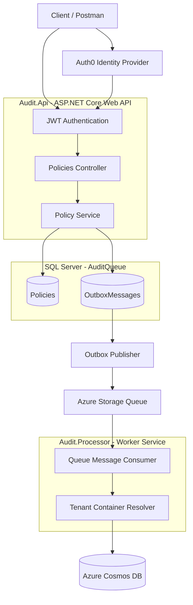

# AuditQueue – Distributed Audit Logging Architecture

A .NET-based distributed audit logging solution demonstrating asynchronous event processing, the Transactional Outbox pattern, Azure Storage Queues, Azure Cosmos DB, multi-tenancy and secure API authentication using Auth0.

The solution is designed to demonstrate how an insurance platform can reliably capture policy changes and process audit events independently of its transactional application.

---

## 1. Project Overview

In a typical insurance platform, policy transactions such as new business, renewals, mid-term adjustments (MTAs) and cancellations generate audit events.

Storing audit information directly within the main transactional database can lead to:

- Increased database storage and maintenance costs.
- Additional load on transactional operations.
- Performance bottlenecks as audit history grows.
- Difficulty scaling audit processing independently.
- Tight coupling between business operations and audit persistence.

AuditQueue demonstrates an alternative approach using asynchronous, event-driven processing.

The transactional application records business changes and corresponding outbox messages in SQL Server. A background processing pipeline subsequently transfers audit events through Azure Storage Queue into Cosmos DB.

**Key objectives:**

- Reliable capture of business events.
- Separation of transactional and audit workloads.
- Asynchronous processing.
- Protection against lost and duplicate messages.
- Multi-tenant audit data isolation.
- Secure API access using OAuth 2.0 and Auth0.
- Independent scalability of API and background processing components.

## 2. Architecture Overview

The solution uses the following technologies:

| Component | Technology |
|---|---|
| API | ASP.NET Core Web API |
| Background processing | .NET Worker Service |
| Transactional database | SQL Server |
| ORM | Entity Framework Core |
| Message queue | Azure Storage Queue |
| Local queue emulator | Azurite |
| Audit persistence | Azure Cosmos DB |
| Local Cosmos emulator | Cosmos DB Emulator |
| Authentication | Auth0 / OAuth 2.0 / JWT |
| Testing | xUnit |
| Development environment | macOS / Docker |

### High-level architecture



The API and background processor are separate deployable components, allowing each to scale independently.

## 3. Solution Structure

The solution is organised into separate projects with clear responsibilities.

```text
AuditQueue/
│
├── Audit.Api/
│   ├── Controllers/
│   ├── Properties/
│   ├── Program.cs
│   └── appsettings.json
│
├── Audit.Application/
│   ├── Abstractions/
│   ├── Policies/
│   └── DependencyInjection.cs
│
├── Audit.Contracts/
│   └── AuditEvent.cs
│
├── Audit.Infrastructure/
│   ├── Cosmos/
│   ├── Data/
│   │   ├── Entities/
│   │   ├── Migrations/
│   │   └── Repositories/
│   ├── Queues/
│   ├── Tenancy/
│   └── DependencyInjection.cs
│
├── Audit.Processor/
│   ├── Program.cs
│   └── Worker.cs
│
├── Audit.Tests/
│   ├── Cosmos/
│   ├── Data/
│   └── SqliteAuditDatabase.cs
│
├── AuditQueue.slnx
├── .gitignore
├── .gitattributes
└── README.md
```

### Project responsibilities

**Audit.Api**

ASP.NET Core Web API responsible for:

- Exposing policy-related endpoints.
- Validating incoming JWT access tokens.
- Enforcing authorisation policies.
- Extracting authenticated identity and tenant context.
- Invoking application services.

**Audit.Application**

Contains business logic and application abstractions.

- PolicyService.
- Policy status change operations.
- Repository interfaces.
- Unit of Work abstraction.
- Application-level orchestration.

**Audit.Contracts**

Contains shared contracts used between components.

- Audit event definitions.
- Message contracts.
- Shared data structures.

**Audit.Infrastructure**

Implements external infrastructure dependencies.

- EF Core and SQL Server persistence.
- Transactional Outbox repository.
- Azure Storage Queue integration.
- Cosmos DB repository.
- Tenant container resolution.

**Audit.Processor**

.NET Worker Service responsible for consuming queued audit events and persisting them into Cosmos DB.

**Audit.Tests**

Contains automated tests covering repository and persistence behaviour.

---

## 4. End-to-End Event Processing

Consider an insurance policy where an underwriter changes its status from `Active` to `Cancelled`.

The API exposes the following endpoint:

```http
POST /api/policies/{policyId}/status
```

The endpoint requires authentication and the `QueueWrite` authorisation policy.

The processing sequence is:

1. The client obtains an access token from Auth0.
2. The client calls the policy API with the bearer token.
3. ASP.NET Core validates the JWT.
4. The API extracts the authenticated identity and tenant context from the ClaimsPrincipal.
5. The PolicyService processes the status change.
6. The policy update and corresponding outbox message are saved within the same SQL Server transaction.
7. An outbox publishing component publishes the event to Azure Storage Queue.
8. The background Worker Service retrieves the message.
9. The processor resolves the correct tenant-specific Cosmos DB container.
10. The audit event is persisted in Cosmos DB.
11. The queue message is deleted only after successful persistence.

The important principle is that the business transaction does not depend on Cosmos DB being available.

## 5. Transactional Outbox Pattern

One of the most important architectural decisions is the use of the Transactional Outbox pattern.

### The problem

Consider the following implementation:

```csharp
await policyRepository.UpdateAsync(policy);

await queueSender.SendAsync(auditEvent);
```

What happens if the SQL transaction succeeds but the queue operation fails?

The policy is updated, but the corresponding audit event is lost.

This creates an inconsistency between transactional data and audit history.

### The solution

Use an Outbox table within the same SQL Server database as the transactional policy data.

The transaction contains two operations:

1. Update the policy.
2. Insert an outbox message.

Both operations commit or roll back together.

Conceptually:

```csharp
await using var transaction =
    await dbContext.Database.BeginTransactionAsync();

policy.Status = newStatus;

var outboxMessage = new OutboxMessage
{
    EventId = Guid.NewGuid(),
    EventType = "PolicyStatusChanged",
    PayloadJson = JsonSerializer.Serialize(auditEvent)
};

dbContext.OutboxMessages.Add(outboxMessage);

await dbContext.SaveChangesAsync();

await transaction.CommitAsync();
```

The publishing component subsequently reads unpublished outbox records and sends them to Azure Storage Queue.

Once queue submission succeeds, the outbox record is marked as published.

### Benefits

- Prevents lost events when the queue is unavailable.
- Maintains consistency between policy updates and event creation.
- Decouples business transactions from asynchronous processing.
- Allows failed publishing attempts to be retried.

The Outbox pattern provides reliable event publication without requiring a distributed transaction between SQL Server and the queue.

---

## 6. Azure Storage Queue

Azure Storage Queue provides asynchronous communication between the transactional application and the background processor.

For local development, the solution uses Azurite.

**Queue configuration:**

| Setting | Value |
|---|---|
| Queue name | `audit-events` |
| Poison queue | `audit-events-poison` |
| Local connection | `UseDevelopmentStorage=true` |

### Why Azure Storage Queue?

- Simple and cost-effective messaging.
- Decouples API processing from audit persistence.
- Supports independent scaling of consumers.
- Provides message visibility timeout and retry behaviour.
- Supports asynchronous processing.

### Message processing considerations

Azure Storage Queue provides at-least-once delivery semantics.

This means a message can potentially be delivered more than once.

For example:

1. Worker retrieves an audit message.
2. Worker successfully writes the event to Cosmos DB.
3. Worker crashes before deleting the queue message.
4. The message becomes visible again.
5. Another processing attempt retrieves the same event.

This is why consumer-side idempotency is essential.

---

## 7. Background Processing – Audit.Processor

The API does not directly write audit events into Cosmos DB.

Instead, a separate .NET Worker Service consumes messages from Azure Storage Queue.

This separation provides:

- Independent deployment.
- Independent scaling.
- Isolation of processing failures.
- Reduced load on the API.
- Ability to process events asynchronously.

The worker is responsible for:

1. Retrieving queue messages.
2. Deserialising the event contract.
3. Resolving tenant context.
4. Persisting the event in Cosmos DB.
5. Deleting the queue message after successful persistence.

If processing fails, the message should remain available for retry rather than being deleted prematurely.

---

## 8. Cosmos DB – Multi-Tenant Audit Storage

The platform is designed around a multi-tenant insurance architecture.

A client represents an underwriter.

The transactional SQL Server database contains a `Client` table identifying the underwriter.

Different underwriters can configure different insurance products.

### Cosmos DB organisation

Rather than creating a separate Cosmos DB account or database for every underwriter, the design uses:

- A shared Cosmos DB account.
- A shared database.
- Tenant-specific containers.

Conceptually:

```text
Cosmos DB Account
│
└── AuditPlatform (Database)
    │
    ├── Underwriter001 (Container)
    │
    ├── Underwriter002 (Container)
    │
    └── Underwriter003 (Container)
```

The infrastructure layer contains a tenant container resolver responsible for selecting the appropriate container.

### Partitioning strategy

The `packageId` is used as the partition key.

A package represents an insurance product configured by an underwriter.

This allows related audit events for a product to be grouped within the same logical partition.

### Audit event identification

Every audit event has a stable, unique `EventId`.

The same `EventId` is used as the Cosmos DB document ID.

This is important for idempotent processing.

If a message is delivered again, the consumer can identify that the event has already been persisted rather than creating a duplicate audit record.

---

## 9. Idempotency and Duplicate Message Handling

Because Azure Storage Queue supports at-least-once delivery, duplicate processing must be expected.

The solution uses a stable `EventId` generated when the business event is created.

The same identifier travels through:

- The SQL Server Outbox.
- The Azure Storage Queue message.
- The Cosmos DB document.

Using the `EventId` as the Cosmos document ID allows the consumer to implement idempotent persistence.

The processing logic must distinguish between:

- A genuinely new event.
- An event that has already been persisted.
- A transient processing failure.
- A permanent processing failure.

The consumer should treat an already-persisted event as successfully processed and allow the queue message to be deleted.

This prevents duplicate audit records during retries.

---

## 10. Retry and Poison Message Handling

Transient failures can occur at different points in the processing pipeline.

Examples include:

- Cosmos DB temporarily unavailable.
- Network connectivity issues.
- Queue service interruptions.
- Request throttling.
- Invalid event payloads.

### Retry strategy

Transient failures should be retried using a controlled retry policy.

A typical strategy uses exponential backoff to avoid repeatedly hitting an unavailable dependency.

### Poison queue

Messages that repeatedly fail processing should eventually be moved to the `audit-events-poison` queue.

The poison queue provides a mechanism for isolating messages that cannot be processed successfully.

### Manual recovery

A poison message should not simply be discarded.

A recovery process should:

1. Inspect the failed message.
2. Identify the root cause.
3. Correct the underlying issue.
4. Validate whether the message can be replayed.
5. Reprocess the message.
6. Confirm successful persistence in Cosmos DB.

The poison queue and recovery workflow are design responsibilities of the processing pipeline; the complete operational recovery mechanism should be implemented and verified separately.

---

## 11. Auth0 Authentication and Authorisation

The API uses Auth0 as its identity provider.

The configuration was created specifically for local development.

### Auth0 API

| Setting | Value |
|---|---|
| API name | LocalDev-Queue-API |
| Audience | `https://localdev-queue-api` |
| Signing algorithm | RS256 |

The API uses JWT Bearer authentication middleware.

The middleware validates:

- Token signature.
- Issuer.
- Audience.
- Expiry.

After successful validation, ASP.NET Core creates a `ClaimsPrincipal` representing the authenticated identity.

### Authorisation scopes

The proposed API permissions are:

| Scope | Purpose |
|---|---|
| `queue:read` | Read operations |
| `queue:write` | Submit policy changes and queue-related operations |
| `queue:process` | Processing-related operations |

The API uses authorisation policies to protect endpoints.

### Identity and tenant claims

An important distinction exists between the following JWT claims:

- `sub`: identifies the token subject.
- `client_id`: identifies the OAuth client application.
- `scope` / `permissions`: represent granted authorisation permissions.

The OAuth `client_id` must not automatically be treated as the insurance underwriter or tenant identifier.

For the multi-tenant design, a separate namespaced custom claim was proposed:

```text
https://localdev-queue-api/claims/client_id
```

This claim would carry the underwriter tenant identifier.

The exact custom tenant claim configuration and its use in issued tokens must be completed and verified before treating this as a production-ready tenant identification mechanism.

The API should extract identity and claims from the authenticated `ClaimsPrincipal`, rather than manually decoding JWT tokens.

### Postman testing

A separate Auth0 application called `LocalDev-Postman` was configured for Client Credentials testing.

This provides an application identity for API testing.

It is important to distinguish application authentication from human-user authentication: a Client Credentials token represents the calling application, not an individual underwriter or agent.

---

## 12. Local Development Environment

The solution is designed to run locally without requiring Azure resources for its development workflow.

### Prerequisites

- macOS
- .NET 10 SDK
- Docker Desktop
- SQL Server running in Docker
- Azurite
- Azure Cosmos DB Emulator
- Auth0 development tenant

### Local infrastructure

| Dependency | Local configuration |
|---|---|
| SQL Server | `localhost,1434` |
| SQL database | `AuditQueue` |
| Azurite | `UseDevelopmentStorage=true` |
| Queue | `audit-events` |
| Poison queue | `audit-events-poison` |
| Cosmos endpoint | `http://localhost:8081` |
| Cosmos database | `AuditPlatform` |
| API audience | `https://localdev-queue-api` |

The SQL Server Docker container is exposed on host port `1434`.

The application runs on the Mac host and connects to the container through localhost.

### Configuration

The API contains:

```text
Audit.Api/
    appsettings.json
    appsettings.Development.json
    appsettings.Development.example.json
```

`appsettings.Development.json` contains local connection details and credentials and should not be committed to source control.

To create your local configuration after cloning:

```bash
cp Audit.Api/appsettings.Development.example.json \
   Audit.Api/appsettings.Development.json
```

Update the values for:

- SQL Server connection string.
- Cosmos DB endpoint and key.
- Auth0 domain.
- Auth0 audience.

Keep actual credentials out of GitHub.

---

## 13. Database Migrations

Entity Framework Core migrations manage the SQL Server database schema.

The transactional database is named:

```text
AuditQueue
```

To apply migrations, run:

```bash
dotnet ef database update \
  --project Audit.Infrastructure \
  --startup-project Audit.Api
```

The database contains the transactional policy and outbox persistence structures.

The database name is intentionally `AuditQueue`, not `AuditQueueBlueprint`.

---

## 14. Running the Application

Once the local dependencies are running and configuration has been completed:

### Build the solution

```bash
dotnet build AuditQueue.slnx
```

### Apply database migrations

```bash
dotnet ef database update \
  --project Audit.Infrastructure \
  --startup-project Audit.Api
```

### Start the API

```bash
dotnet run --project Audit.Api
```

### Start the background processor

In another terminal window:

```bash
dotnet run --project Audit.Processor
```

### Run automated tests

```bash
dotnet test Audit.Tests
```

---

## 15. Testing

The `Audit.Tests` project contains tests covering persistence and repository behaviour.

The existing test organisation includes:

- Cosmos audit repository tests.
- Outbox repository tests.
- Policy repository tests.
- SQLite-based audit database test support.

The intention is to test business logic and persistence independently of the external services wherever possible.

Further integration testing should cover the complete lifecycle from policy update and outbox creation through queue publication and Cosmos persistence.

---

## 16. Architectural Decisions and Trade-offs

| Decision | Reason | Trade-off |
|---|---|---|
| Transactional Outbox | Prevents lost events between SQL transactions and queue publishing | Additional database table and publisher |
| Azure Storage Queue | Decouples API and processing | At-least-once delivery requires idempotency |
| Separate Worker Service | Independent processing and scaling | Additional deployment component |
| Cosmos DB | Scalable audit event storage | Eventual consistency and additional infrastructure |
| Tenant-specific containers | Logical separation of underwriter audit data | Container management overhead |
| `packageId` partition key | Groups events by insurance product | Partition distribution must be monitored |
| Stable EventId | Supports duplicate detection | Requires consistent identifier propagation |
| Auth0 | Centralised authentication and token validation | External identity provider dependency |

---

## 17. Future Improvements

Potential areas for further development include:

- Automated Outbox publishing with scheduled polling.
- Configurable exponential backoff and retry policies.
- Automated poison queue processing and replay tooling.
- Operational dashboards for queue depth and processing failures.
- Application Insights and distributed tracing.
- Cosmos DB throughput and partition monitoring.
- Improved integration and end-to-end testing.
- Infrastructure deployment using Bicep or Terraform.
- Production-ready managed identity and secret management.
- Tenant provisioning and container lifecycle management.

---

## 18. Learning Outcomes

This project demonstrates practical implementation and architectural considerations around:

- Clean Architecture and separation of concerns.
- Domain-driven application design.
- Transactional Outbox pattern.
- Event-driven architecture.
- Asynchronous messaging.
- Azure Storage Queue.
- Background processing with .NET Worker Services.
- Entity Framework Core and SQL Server.
- Azure Cosmos DB.
- Multi-tenant data architecture.
- Idempotent event processing.
- Retry and poison message handling.
- OAuth 2.0, JWT and Auth0.
- Automated testing.

---

## 19. Repository

GitHub: https://github.com/BedfordNightWalkers/AuditQueue

**Project:** AuditQueue

**Purpose:** Demonstrate a scalable, resilient and multi-tenant distributed audit logging architecture using .NET and Azure technologies.

